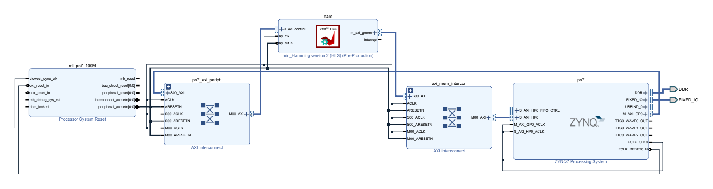
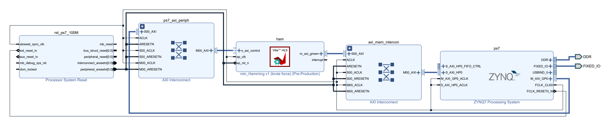
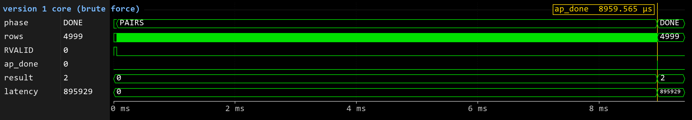
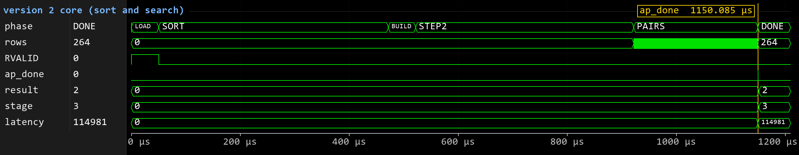

# Minimum Hamming Distance of 32-bit Words: Processing Time vs. Memory Size

Two C implementations of the same function, one built for the smallest memory and
one built for the shortest time, measured on a PC, on the ARM Cortex-A9 of a
Zynq-7020, and as Vitis HLS hardware cores in its FPGA fabric (AXI4-Lite control,
AXI4 master to DDR).


**[Report (PDF)](report/min_hamming_report.pdf)** · [Measured results](results/) ·
[RTL simulation](sim/) · [Version 1](version_1/) · [Version 2](version_2/)

---

## Contents

1. [The task](#the-task)
2. [Results at a glance](#results-at-a-glance)
3. [The two versions](#the-two-versions)
4. [FPGA cores (Vitis HLS)](#fpga-cores-vitis-hls)
5. [Zynq system and AXI interface](#zynq-system-and-axi-interface)
6. [RTL simulation](#rtl-simulation)
7. [Verification](#verification)
8. [Repository layout](#repository-layout)
9. [Build and run](#build-and-run)
10. [Tools](#tools)
11. [Author](#author)

---

## The task

> Write a C function that computes the minimum Hamming distance between the 32-bit
> words of an array, and optimize the processing time and the memory size required
> to compute the result as much as you can.

```c
int min_Hamming(unsigned int tab[], unsigned int tab_size);
```

The Hamming distance of two words is the number of bit positions where they
differ, i.e. the number of 1-bits in their XOR. The function returns the smallest
distance over all pairs of words (0 to 32), or `-1` when the array holds fewer
than two words. The FPGA cores also return `-2` for arrays larger than the 8,192
words they can hold on chip.

The two goals conflict: the fast methods keep extra data (such as a sorted copy
of the array), while the smallest method compares the words where they are. So
instead of one compromise, there are two versions, and both goals were measured
for each.

## Results at a glance

One call on the benchmark array of `main.c`: 5,000 random words from MT19937
(seed 42), smallest distance 2.

| Measure | Version 1 (brute force) | Version 2 (sort + search) | Better |
|---|---:|---:|:---|
| PC, scalar build (`gcc -O2 -mpopcnt`) | 303.3 ms | 5.90 ms | V2, 51× |
| PC, AVX2 build (`gcc -O3 -march=native`) | 34.9 ms | 5.98 ms | V2, 5.8× |
| ARM Cortex-A9 at 666.67 MHz | 2,699.6 ms | 72.4 ms | V2, 37× |
| FPGA core at 100 MHz | 9.008 ms | 1.150 ms | V2, 7.8× |
| Instructions inside the call (PC, scalar) | 3,336.9 M | 33.0 M | V2, 101× |
| Extra heap, PC / ARM | 0 / 0 | 8N / 4N bytes | V1 |
| Stack during the call, PC | < 128 B | 2,712 B | V1 |
| Code + static data on the ARM | 128 B | 6,810 B | V1, 53× |
| FPGA core: LUTs / flip-flops / BRAM tiles | 2,557 / 3,328 / 12 | 11,898 / 8,314 / 52.5 | V1, 4.7× fewer LUTs |
| Correctness | all tests pass | all tests pass | tie |

- In a PC sweep of 70 cases (5 sizes from 1,000 to 20,000 words × 7 kinds of
  input × 2 builds), version 2 was faster every time, from 1.34× to 3,222×.
- With no pair closer than 4 bits, so that version 2 can never stop early, it
  is still 28× (scalar) and 2.9× (AVX2) faster.
- On the FPGA, version 2 draws more power (0.331 W vs. 0.090 W, Vivado
  estimate) but finishes sooner, so it uses 2.1× less energy per call.

**Verdict:** version 2 is the better answer overall; version 1 is the right
choice when memory, not time, is the limit.

## The two versions

### Version 1: brute force, optimized for memory size

[`version_1/min_hamming_v1.c`](version_1/min_hamming_v1.c): XOR every pair of
words, count the 1-bits one at a time with a shift-and-test loop, keep the
smallest count.

```c
int min_Hamming(unsigned int tab[], unsigned int tab_size) {
    if (tab_size < 2)
        return -1;
    int best = 32;
    for (unsigned int i = 0; i < tab_size; i++)
        for (unsigned int j = i + 1; j < tab_size; j++) {
            unsigned int diff = tab[i] ^ tab[j];
            int distance = 0;
            for (int bit = 0; bit < 32; bit++)
                if ((diff >> bit) & 1u)
                    distance++;
            if (distance < best)
                best = distance;
        }
    return best;
}
```

- **Time** O(32·N²): always all N(N−1)/2 pairs. One pair costs 267 instructions
  on x86-64 (scalar), 37 when GCC vectorizes it with AVX2, about 201 on the ARM.
- **Extra memory** O(1): a few registers, no allocation, no library call.

### Version 2: sort and search, optimized for processing time

[`version_2/min_hamming_v2.c`](version_2/min_hamming_v2.c): the answer is usually
small, so it tests the smallest possible answers first, each with a method much
cheaper than comparing all pairs.

| Step | Finds | How | Cost |
|---|---|---|---|
| 1 | distance 0 | sort a copy with `qsort`; equal words become neighbours | O(N log N) |
| 2 | distance 1 | for every word, binary-search its 32 one-bit neighbours (`word ^ (1u << bit)`) in the sorted copy; the search is written by hand to avoid `bsearch`'s call through a pointer | O(32·N log N) |
| 3 | distance ≥ 2 | all pairs, counting bits with one instruction (`__builtin_popcount` → `POPCNT`), stopping at the first pair at distance 2 | O(N²) worst case, about 8 instructions per pair |

- **Extra memory** O(N): the sorted copy (4N bytes; `tab[]` itself is not
  reordered) plus a 4N-byte merge buffer inside glibc's `qsort`, so 8N bytes at
  peak on the PC. newlib's `qsort` on the ARM sorts in place: 4N bytes there.
- If `malloc` fails, steps 1 and 2 are skipped and step 3 alone still returns
  the right answer. Compilers without `__builtin_popcount` get a portable
  bit count.
- On the benchmark array: no duplicate (step 1), no one-bit neighbour (160,000
  binary searches, step 2), then step 3 stops after 1,283,201 of the 12,497,500
  pairs (10.3 %). The closest pair is words 263 and 3,180 (`0xB1437CE0`,
  `0xB1437EF0`), which differ only in bits 9 and 4.

Both versions are driven by the same [`main.c`](version_1/main.c): 6
hand-computed tests (answers 4, 0, 1, 2, 32 and −1), then one timed call on N
random words (default 5,000).

## FPGA cores (Vitis HLS)

Both algorithms were rebuilt in C++ for Vitis HLS 2021.1 with the same contract.
Each core is an IP block with an AXI4-Lite control port and an AXI4 master that
reads the words from DDR in bursts.

| | Version 1 core | Version 2 core |
|---|---|---|
| Source | [`version_1/hls/min_hamming_hls.cpp`](version_1/hls/min_hamming_hls.cpp) | [`version_2/hls/min_hamming_hls.cpp`](version_2/hls/min_hamming_hls.cpp) |
| Architecture | copy the words into 16 BRAM banks, then compare 16 pairs per clock (XOR + unrolled 32-bit adder tree + 16-input minimum tree, II = 1) | load, 4-pass LSD radix sort (one word per clock), 13-level search tree in 2 copies (4 look-ups per clock), then 64 pairs per clock with early exit |
| Early exit | no (like the C code) | yes, at distance 2 |
| On-chip copies of the input | 1 (32 KB) | 6 (192 KB) |
| Largest array | 8,192 words (else returns −2) | 8,192 words (else returns −2) |
| Extra output | — | `stage`: the step that decided the answer (1, 2 or 3) |
| Latency, benchmark array | 895,929 cycles | 114,981 cycles |
| LUTs / flip-flops / BRAM tiles (core) | 2,557 / 3,328 / 12 | 11,898 / 8,314 / 52.5 |
| Dynamic power (Vivado estimate) | 0.090 W | 0.331 W |
| Setup slack at 100 MHz (whole design) | +2.952 ns | +0.672 ns |
| Target | xc7z020clg400-1, Zybo Z7-20 | xc7z020clg484-1, ZC702 |

Key interface pragmas (version 1):

```cpp
#pragma HLS INTERFACE m_axi port=tab offset=slave bundle=gmem depth=8192 max_read_burst_length=256
#pragma HLS INTERFACE s_axilite port=tab bundle=control
#pragma HLS INTERFACE s_axilite port=tab_size bundle=control
#pragma HLS INTERFACE s_axilite port=return bundle=control
```

## Zynq system and AXI interface



*Vivado block design of the version 2 system (ZC702). The version 1 system on the
Zybo Z7-20 has the same blocks and connections:*

<details>
<summary>Version 1 block design (Zybo Z7-20)</summary>



</details>

- **Control (AXI4-Lite):** PS `M_AXI_GP0` → AXI Interconnect (`ps7_axi_periph`)
  → core `s_axi_control` at base address `0x43C0_0000`.
- **Data (AXI4):** core `m_axi_gmem` → AXI Interconnect (`axi_mem_intercon`) →
  PS `S_AXI_HP0` → DDR, bursts of up to 256 words, 32-bit addresses.
- **Clock and reset:** `FCLK_CLK0` = 100 MHz for all PL logic; resets from a
  Processor System Reset block (`rst_ps7_100M`). The design uses no PL pins, so
  there is no XDC file.
- The block design, bitstream and XSA are made by
  [`build_hw.tcl`](version_2/zynq/build_hw.tcl); the platform, BSP and bare-metal
  application by [`run_sw.tcl`](version_2/zynq/run_sw.tcl).

### Register map (`s_axi_control`)

| Offset | Register | Access | Meaning |
|---|---|---|---|
| `0x00` | AP_CTRL | R/W | bit 0 `ap_start`, bit 1 `ap_done` (clear on read), bit 2 `ap_idle`, bit 3 `ap_ready`, bit 7 `auto_restart` |
| `0x04` | GIE | R/W | global interrupt enable |
| `0x08` | IER | R/W | bit 0 `ap_done`, bit 1 `ap_ready` interrupt enable |
| `0x0C` | ISR | R/TOW | interrupt status |
| `0x10` | `ap_return` | R | smallest distance, −1 or −2 |
| `0x18` | `tab` | R/W | DDR address of the array |
| `0x20` | `tab_size` | R/W | number of words |
| `0x28` | `stage` | R | version 2 only: step that decided the answer |
| `0x2C` | `stage` control | R | version 2 only: bit 0 `stage_ap_vld` |

### Driving the core from the ARM

Version 1 ([`version_1/zynq/main.c`](version_1/zynq/main.c)) writes the registers
directly:

```c
Xil_DCacheFlushRange((UINTPTR)words, flush_words * sizeof(u32)); // HP0 does not see the CPU cache
Xil_Out32(HAM_BASEADDR + HAM_REG_TAB, (u32)(UINTPTR)words);      // 0x18: array address
Xil_Out32(HAM_BASEADDR + HAM_REG_TAB_SIZE, n);                   // 0x20: number of words
Xil_Out32(HAM_BASEADDR + HAM_REG_CTRL, HAM_CTRL_START);          // 0x00: ap_start
while ((Xil_In32(HAM_BASEADDR + HAM_REG_CTRL) & HAM_CTRL_DONE) == 0U)
    ;                                                            // poll ap_done (with a timeout)
*result = (int)Xil_In32(HAM_BASEADDR + HAM_REG_RETURN);          // 0x10: answer
```

Version 2 ([`version_2/zynq/main.c`](version_2/zynq/main.c)) uses the driver that
Vitis HLS generates (`XMin_hamming_hls_Set_tab`, `_Set_tab_size`, `_Start`,
`_IsDone`, `_Get_return`, `_Get_stage`). It also times version 1 and version 2 on
the ARM in the same program ([`ham_v1_arm.c`](version_2/zynq/ham_v1_arm.c)) and
checks the core against the ARM on 300 random arrays.

Notes:
- The core reads DDR through `S_AXI_HP0`, which does not see the ARM data cache,
  so every call flushes the array from the cache first.
- Version 2 calls `malloc`, so its board build reserves a 1 MB heap
  (`-Wl,--defsym=_HEAP_SIZE=0x100000` in `run_sw.tcl`); with the BSP default of
  8 KB, `malloc` would fail near N = 2,048.
- The board programs print to PS UART1 at 115200 8N1 and end with
  `ALL TESTS PASSED` or `TESTS FAILED`.

## RTL simulation

The Verilog that Vitis HLS generated for each core ([`sim/rtl`](sim/rtl)) is
simulated with Icarus Verilog. The testbench
[`sim/tb_min_hamming.v`](sim/tb_min_hamming.v) acts like the ARM program: it
writes `tab`, `tab_size` and `ap_start` over AXI4-Lite, answers the core's AXI4
read bursts from a memory model holding main.c's 5,000 words, polls `ap_done`
and reads the result. [`sim/plot_waves.py`](sim/plot_waves.py) draws the figures
below from the VCD files.





- **Version 1:** copies the words in (50 µs), works through 4,999 rows of pairs
  and raises `ap_done` after **895,929 cycles** (8.96 ms at 100 MHz).
- **Version 2:** LOAD (50 µs), SORT (421 µs), BUILD the search tree (50 µs),
  STEP2 (400 µs), then PAIRS finds a distance-2 pair after 264 blocks:
  **114,981 cycles** (1.150 ms), the same time as on the board.
- Both cores return 2. `phase` and `rows` are helper signals of the testbench;
  `result` and `stage` are the values it reads back over AXI4-Lite.

## Verification

| Level | What | Result |
|---|---|---|
| C, PC | 6 hand-computed tests in `main.c`; both versions on 20,005 random arrays | identical answers |
| HLS, version 1 | C simulation against `min_hamming_v1.c`: the hand tests, sizes around the lane width, pairs on the row boundaries, the benchmark | all tests passed, 0 errors ([log](results/hls/v1_vitis_hls.log)) |
| HLS, version 2 | C model regression (native g++), C simulation, C/RTL co-simulation, all against `min_hamming_v2.c`, answer **and** deciding step | 420 + 218 cases, 0 failures; co-sim latency up to 115,053 cycles |
| RTL, both | Icarus Verilog, testbench in `sim/` | both return 2 ([results/sim](results/sim/icarus_results.txt)) |
| Board, version 1 | Zybo Z7-20: the 6 tests on the core and the ARM, plus 8,193 words → −2 | 7 tests pass ([UART log](results/board/v1_board_uart.log)) |
| Board, version 2 | ZC702: the 6 tests, an empty array, 8,193 words, 300 random arrays vs. the ARM | 0 mismatches ([UART log](results/board/v2_board_uart.log)) |

The reports behind the FPGA numbers are in [`results/fpga`](results/fpga) (Vivado
utilization, timing, power) and [`results/hls`](results/hls) (synthesis,
co-simulation); the PC timing logs, Callgrind and Massif outputs are in
[`results/pc`](results/pc).

## Repository layout

```
.
├── version_1/                    brute force, optimized for memory
│   ├── min_hamming_v1.c          the function
│   ├── main.c                    6 tests + one timed call on N random words
│   ├── hls/                      HLS core: 16 pairs per clock
│   │   ├── min_hamming_hls.cpp / .h
│   │   ├── tb_min_hamming_hls.cpp    testbench against min_hamming_v1.c
│   │   └── run_hls.tcl               csim, csynth, (cosim), IP export
│   └── zynq/                     Zybo Z7-20 system
│       ├── build_hw.tcl          Vivado: block design, bitstream, XSA
│       ├── run_sw.tcl            Vitis: platform, BSP, application; JTAG run
│       ├── main.c                bare-metal test, direct AXI4-Lite register access
│       ├── run_all.sh            push-button flow: hls -> hw -> sw -> run
│       ├── export_bd_pdf.tcl     saves the block design diagram as PDF
│       └── board_files/          Digilent Zybo Z7-20 board files (MIT License)
├── version_2/                    sort and search, optimized for time
│   ├── min_hamming_v2.c
│   ├── main.c
│   ├── pc_baseline.sh            PC timing logs and a v1/v2 sweep with Massif
│   ├── hls/                      HLS core: radix sort, search tree, 64 pairs per clock
│   └── zynq/                     ZC702 system (same scripts as version 1)
│       ├── main.c                bare-metal test with the generated driver
│       └── ham_v1_arm.c          builds version 1 into the same ARM program
├── sim/                          RTL simulation of both cores
│   ├── tb_min_hamming.v          AXI4-Lite master + AXI4 memory model
│   ├── run_icarus.bat            Icarus Verilog run and figures (Windows)
│   ├── plot_waves.py             waveform figures from the VCD files
│   ├── run_waves.bat, run_waves.do, snap.py   optional QuestaSim run with screenshots
│   └── rtl/v1, rtl/v2            Verilog generated by Vitis HLS 2021.1
├── results/                      measured data behind the numbers above
│   ├── pc/  hls/  fpga/  board/  sim/
├── report/                       IEEE-style report: PDF, LaTeX source, figures
└── docs/                         images used in this README
```

## Build and run

### PC (Linux, GCC)

```sh
cd version_1
gcc -O2 -mpopcnt -Wall -std=c11 main.c min_hamming_v1.c -o ham_v1
./ham_v1            # 6 tests, then the benchmark on 5,000 words
./ham_v1 20000      # another array size

cd ../version_2
gcc -O2 -mpopcnt -Wall -std=c11 main.c min_hamming_v2.c -o ham_v2
./ham_v2
./pc_baseline.sh    # timing logs (15 runs), AVX2 build, v1 vs v2 sweep with Massif
```

The AVX2 build is the same with `gcc -O3 -march=native -std=c11`.
`pc_baseline.sh` needs Valgrind and `bc`.

### FPGA and board (Linux, Vitis HLS / Vivado / Vitis 2021.1)

The board is connected over JTAG and USB-UART. One script runs the whole flow
for each version:

```sh
cd version_1/zynq       # Zybo Z7-20      (version_2/zynq for the ZC702)
./run_all.sh            # hls -> hw -> sw -> run
./run_all.sh build      # hls -> hw -> sw, no board needed
./run_all.sh run        # program the board and run the test only
XILINX_ROOT=/opt/Xilinx ./run_all.sh    # if the tools are not in /tools/Xilinx
```

Stages: `hls`, `hw`, `sw`, `run`, `build`, `all`. Each run is saved in
`zynq/results/<date>_<time>_<stage>/` (summary, logs, reports, UART output).
Other variables: `XILINX_VER` (default 2021.1), `UART_DEV`, `UART_WAIT`,
`COSIM=1` (version 1: also run the RTL co-simulation).

The HLS step on its own:

```sh
cd version_1/hls && vitis_hls -f run_hls.tcl      # COSIM=1 for C/RTL co-simulation
cd version_2/hls && vitis_hls -f run_hls.tcl      # csim csynth cosim export
vitis_hls -f run_hls.tcl -tclargs csim csynth     # version 2: any subset of stages
```

The `run_hls.tcl` scripts add a few link flags for Ubuntu 24.04 with the tools on
an NTFS drive; they are harmless on a normal install.

### RTL simulation (Icarus Verilog)

On Windows, run `sim\run_icarus.bat` (Icarus Verilog and Python 3 with Pillow on
the PATH). On Linux or macOS, the same steps are:

```sh
cd sim
iverilog -DCORE_V1 -DDUMP_VCD -s tb_min_hamming -o v1.vvp rtl/v1/*.v tb_min_hamming.v
iverilog -DCORE_V2 -DDUMP_VCD -s tb_min_hamming -o v2.vvp rtl/v2/*.v tb_min_hamming.v
vvp -n v1.vvp           # about 7 minutes, writes waves_v1.vcd
vvp -n v2.vvp           # about 2 minutes, writes waves_v2.vcd
python3 plot_waves.py   # ../report/figures/wave_v1.png and wave_v2.png
```

Each run prints a `RESULT` line (answer, latency, rows) and `TEST PASSED`. The
VCD files can also be opened in GTKWave.


## Tools

- **PC:** Intel Core i5-1135G7 (Tiger Lake), Ubuntu 24.04, GCC 13.3, glibc 2.39,
  Valgrind 3.22 (Massif, Callgrind)
- **FPGA:** Vitis HLS, Vivado and Vitis 2021.1; bare-metal standalone BSP,
  `arm-none-eabi-gcc -O2`, newlib
- **Boards:** Digilent Zybo Z7-20 (version 1) and AMD Xilinx ZC702 (version 2),
  both XC7Z020-1: ARM at 666.67 MHz, DDR3 at 533 MHz, PL at 100 MHz
- **Simulation:** Icarus Verilog 13, Python 3 with Pillow (QuestaSim optional)
- **Report:** LaTeX (IEEEtran), Overleaf

**Third-party files:** `version_1/zynq/board_files/` holds Digilent's Zybo Z7-20
board files (MIT License, notice in each file). `sim/rtl/` holds Verilog
generated by Vitis HLS 2021.1 from the HLS sources in this repository.

---

<a name="author"></a>
<div align="center">

### 👨‍💻 Author

**Ahmed Saad Sweffi**

[](https://www.linkedin.com/in/ahmed-saad-sweffi-09b2751a9)

*Digital Design & Verification Engineer — RTL • FPGA • VLSI*

</div>
